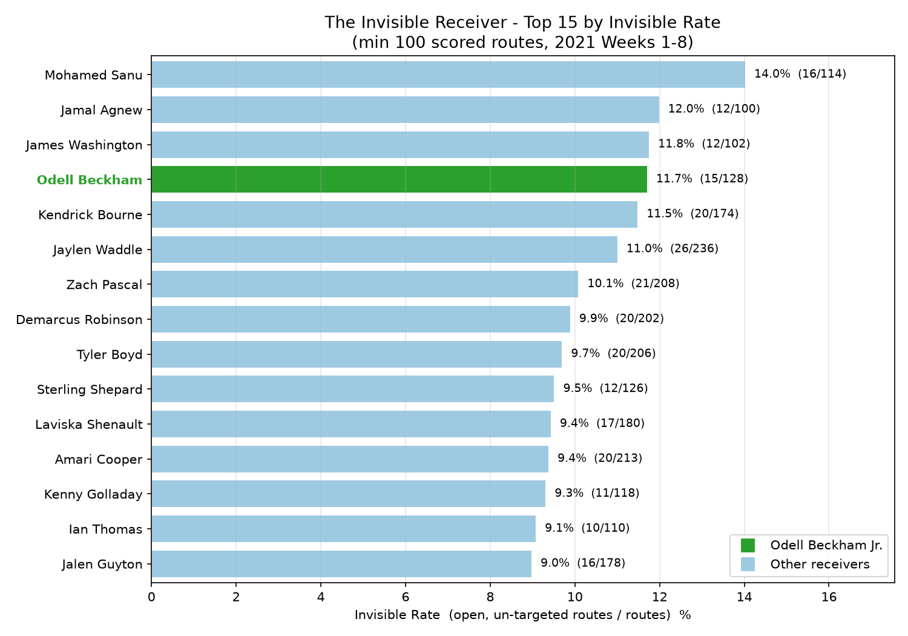
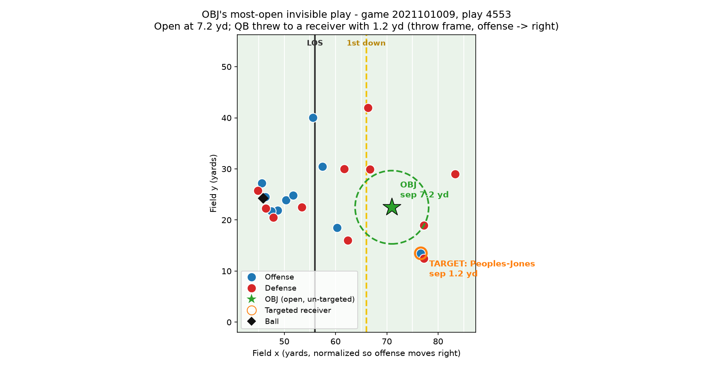

# The Invisible Receiver

We built **Invisible Rate**, a metric that measures how often a WR or TE is clearly open at the moment the quarterback throws (3+ yards from the nearest defender and more open than the receiver actually targeted) but still doesn't get the ball. Using 2021 NFL tracking data from Weeks 1–8, we measured every receiver's separation at the throw, identified the real target from the play description, and excluded chip blockers who only look open because they stayed in to block. Odell Beckham Jr. ranks #4 of 122 receivers (11.7%), and he stays in the top 4 at every threshold we tested, matching the real "OBJ is always open" story that led to his release from Cleveland in November 2021. Coaches can use it to check whether their QB is missing open receivers, scouts to find receivers who are better than their stats show, and broadcasters to show fans the open man the QB missed. Our main assumption is that open at the throw means a real opportunity, but tracking data can't see the QB's reads or throwing lanes, and samples per player are small (100–250 routes).

**Run:** put the dataset in `data/`, then `pip install -r requirements.txt`, `python invisible_receiver.py`, `python viz.py`.